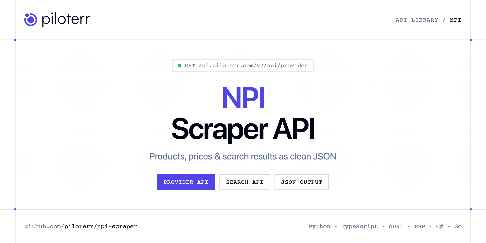

<p align="center">
  <a href="https://www.piloterr.com"></a>
</p>

# NPI Scraper API

[](https://discord.gg/CFj3ph8aHU) [](https://app.piloterr.com) [](https://app.piloterr.com/openapi) [](LICENSE)

The **Piloterr NPI Scraper API** lets you extract public data from NPI as **clean, structured JSON** — no proxies, headless browsers or HTML parsing to maintain. Endpoints available in production:

- **NPI Provider API** — Fetch one NPPES provider or organization by 10-digit NPI or provider-view URL, including addresses and taxonomies.
- **NPI Search API** — Search the NPPES NPI registry by person name, organization, or 10-digit NPI.

Use it for price monitoring, assortment tracking, competitor analysis, product research or catalog enrichment.

| Endpoint | Path | Credits | What you get |
|---|---|---|---|
| [NPI Provider API](#npi-provider-api) | `/v2/npi/provider` | 1 | Fetch one NPPES provider or organization by 10-digit NPI or provider-view URL, including addresses and taxonomies. |
| [NPI Search API](#npi-search-api) | `/v2/npi/search` | 1 | Search the NPPES NPI registry by person name, organization, or 10-digit NPI. With NPI-2, a text query is the organization name. total_results is null, and next is set only when the page is full. |

## Table of contents

- [How it works](#how-it-works)
- [NPI Provider API](#npi-provider-api)
- [NPI Search API](#npi-search-api)
- [Code examples in other languages](#code-examples-in-other-languages)
- [Practical use cases](#practical-use-cases)
- [Why Piloterr?](#why-piloterr)
- [FAQ](#faq)
- [Related scrapers](#related-scrapers)
- [Support](#support)

## How it works

1. **Create a free Piloterr account** and copy your API key from the [dashboard](https://app.piloterr.com).
2. **Send a `GET` (or `POST`) request** to `https://api.piloterr.com/v2/...` with the header `x-api-key: YOUR_API_KEY`.
3. **Receive structured JSON** — Piloterr handles rendering, proxies, retries and parsing.

```bash
export PILOTERR_API_KEY="your-api-key"
pip install requests        # Python
# TypeScript: Node.js 18+ (native fetch), run with `npx tsx file.ts`
```

> Every endpoint accepts both `GET` (query string) and `POST` (JSON body with the same fields).

## NPI Provider API

Fetch one NPPES provider or organization by 10-digit NPI or provider-view URL, including addresses and taxonomies.

`GET | POST https://api.piloterr.com/v2/npi/provider` · **1 credit per request** · [Full reference](https://app.piloterr.com/openapi)

### Request parameters

| Parameter | Type | Required | Description |
|---|---|---|---|
| `query` | string | ✅ | Required. 10-digit NPI, example 1972813608, or a provider-view URL such as https://npiregistry.cms.hhs.gov/provider-view/1972813608. |

### Python example

```python
import json
import os
import requests

response = requests.get(
    "https://api.piloterr.com/v2/npi/provider",
    headers={"x-api-key": os.environ["PILOTERR_API_KEY"]},
    params={
        "query": "https://npiregistry.cms.hhs.gov/provider-view/1972813608",
    },
    timeout=120,
)
response.raise_for_status()
data = response.json()

print(json.dumps(data, indent=2, ensure_ascii=False)[:2000])
```

### TypeScript example

```typescript
type NpiProvider = {
  npi?: string;
  sex?: string;
  url?: string;
  city?: string;
  name?: string;
  phone?: string;
  state?: string;
  status?: string;
  address?: string;
  taxonomy?: string;
  addresses?: {
    city?: string;
    type?: string;
    line1?: string;
    phone?: string;
    state?: string;
    country?: string;
    purpose?: string;
    postal_code?: string;
    country_code?: string;
  }[];
  last_name?: string;
  credential?: string;
  first_name?: string;
  taxonomies?: {
    code?: string;
    group?: unknown;
    state?: string;
    license?: string;
    primary?: boolean;
    description?: string;
  }[];
  identifiers?: unknown[];
  middle_name?: string;
  name_prefix?: string;
  name_suffix?: unknown;
  other_names?: unknown[];
  postal_code?: string;
  last_updated?: string;
  taxonomy_code?: string;
  sole_proprietor?: string;
  enumeration_date?: string;
  [key: string]: unknown;
};

const params = new URLSearchParams({
  "query": "https://npiregistry.cms.hhs.gov/provider-view/1972813608",
});

const response = await fetch(`https://api.piloterr.com/v2/npi/provider?${params}`, {
  headers: { "x-api-key": process.env.PILOTERR_API_KEY! },
});
if (!response.ok) throw new Error(`Piloterr error ${response.status}: ${await response.text()}`);

const data = (await response.json()) as NpiProvider;

console.log(JSON.stringify(data, null, 2).slice(0, 2000));
```

<details>
<summary><b>POST variant</b></summary>

```http
POST https://api.piloterr.com/v2/npi/provider
x-api-key: YOUR_API_KEY
Content-Type: application/json

{"query": "https://npiregistry.cms.hhs.gov/provider-view/1972813608"}
```
</details>

### Output example

Example response from the API reference, abridged — real values depend on the page you scrape.

```json
{
  "npi": "1972813608",
  "sex": "M",
  "url": "https://npiregistry.cms.hhs.gov/provider-view/1972813608",
  "city": "WASHINGTON",
  "name": "Dr. ANTHONY STEPHEN FAUCI",
  "phone": "example",
  "state": "DC",
  "status": "A",
  "address": "3012 - 43RD STREET, N.W.",
  "taxonomy": "Internal Medicine, Infectious Disease",
  "addresses": [
    {
      "city": "WASHINGTON",
      "type": "DOM",
      "line1": "3012 - 43RD STREET, N.W.",
      "phone": "example",
      "state": "DC",
      "country": "United States",
      "purpose": "MAILING",
      "postal_code": "200163547",
      "country_code": "US"
    },
    {
      "city": "WASHINGTON",
      "type": "DOM",
      "line1": "3012 - 43RD STREET, N.W.",
      "phone": "example",
      "state": "DC",
      "country": "United States",
      "purpose": "LOCATION",
      "postal_code": "200163547",
      "country_code": "US"
    }
  ],
  "last_name": "example",
  "credential": "M.D.",
  "first_name": "example",
  "taxonomies": [
    {
      "code": "207RI0200X",
      "group": null,
      "state": "MD",
      "license": "D0004034",
      "primary": true,
      "description": "Internal Medicine, Infectious Disease"
    }
  ],
  "identifiers": [],
  "middle_name": "STEPHEN",
  "name_prefix": "Dr.",
  "name_suffix": null,
  "other_names": [],
  "postal_code": "200163547",
  "last_updated": "2010-10-15",
  "taxonomy_code": "207RI0200X",
  "sole_proprietor": "YES",
  "enumeration_date": "2010-10-15"
}
```

### Response fields

| Field | Type | Description |
|---|---|---|
| `npi` | string |  |
| `sex` | string |  |
| `url` | string |  |
| `city` | string |  |
| `name` | string |  |
| `phone` | string |  |
| `state` | string |  |
| `status` | string |  |
| `address` | string |  |
| `taxonomy` | string |  |
| `addresses[]` | object[] |  |
| `addresses[].city` | string |  |
| `addresses[].type` | string |  |
| `addresses[].line1` | string |  |
| `addresses[].phone` | string |  |
| `addresses[].state` | string |  |
| `addresses[].country` | string |  |
| `addresses[].purpose` | string |  |
| `addresses[].postal_code` | string |  |
| `addresses[].country_code` | string |  |
| `last_name` | string |  |
| `credential` | string |  |
| `first_name` | string |  |
| `taxonomies[]` | object[] |  |
| `taxonomies[].code` | string |  |

## NPI Search API

Search the NPPES NPI registry by person name, organization, or 10-digit NPI. With NPI-2, a text query is the organization name. total_results is null, and next is set only when the page is full.

`GET | POST https://api.piloterr.com/v2/npi/search` · **1 credit per request** · [Full reference](https://app.piloterr.com/openapi)

### Request parameters

| Parameter | Type | Required | Description |
|---|---|---|---|
| `query` | string | — | Optional when another criterion is set. Example: Anthony Fauci. Also a 10-digit NPI such as 1972813608, or an NPPES search URL. With enumeration_type=NPI-2 this text is the organization name, for example Mayo Clinic. A p… |
| `first_name` | string | — | Optional. Example: Anthony. Used as the given name when you do not want query to be split. |
| `last_name` | string | — | Optional. Example: Fauci. A single-word query such as Smith is used as the last name. |
| `organization_name` | string | — | Optional. Example: Mayo Clinic. You can also pass that name in query with enumeration_type=NPI-2. |
| `city` | string | — | Optional. Practice city. Example: Washington. |
| `state` | string | — | Optional. Two-letter state code. Example: DC. Any other value is rejected. |
| `postal_code` | string | — | Optional. Postal code. Example: 20016. |
| `taxonomy` | string | — | Optional. Taxonomy description. Example: Internal Medicine. |
| `enumeration_type` | string | — | Optional. NPI-1 for a person or NPI-2 for an organization. Example: NPI-2. NPI-2 treats a text query as an organization name. |
| `page` | number | — | Optional. Page number, starting at 1. Example: 2. Defaults to 1. |
| `limit` | number | — | Optional. Page size. Example: 10. Defaults to 10 and cannot exceed 200. next is a URL only when the page contains this many rows. |

### Python example

```python
import json
import os
import requests

response = requests.get(
    "https://api.piloterr.com/v2/npi/search",
    headers={"x-api-key": os.environ["PILOTERR_API_KEY"]},
    params={
        "query": "Anthony Fauci. Also a 10-digit NPI such as 1972813608, or an NPPES search URL. With enumeration_type=NPI-2 this text is the organization name, for example Mayo Clinic. A provider-view URL is rejected here.",
    },
    timeout=120,
)
response.raise_for_status()
data = response.json()

print(json.dumps(data, indent=2, ensure_ascii=False)[:2000])
```

### TypeScript example

```typescript
type NpiSearch = {
  results?: {
    npi?: string;
    url?: string;
    city?: string;
    name?: string;
    phone?: string;
    state?: string;
    status?: string;
    address?: string;
    taxonomy?: string;
    last_name?: string;
    credential?: string;
    first_name?: string;
    middle_name?: string;
    postal_code?: string;
    taxonomy_code?: string;
    enumeration_date?: string;
    enumeration_type?: string;
    organization_name?: unknown;
  }[];
  pagination?: {
    next?: unknown;
    page?: number;
    per_page?: number;
    total_pages?: unknown;
    total_results?: unknown;
  };
};

const params = new URLSearchParams({
  "query": "Anthony Fauci. Also a 10-digit NPI such as 1972813608, or an NPPES search URL. With enumeration_type=NPI-2 this text is the organization name, for example Mayo Clinic. A provider-view URL is rejected here.",
});

const response = await fetch(`https://api.piloterr.com/v2/npi/search?${params}`, {
  headers: { "x-api-key": process.env.PILOTERR_API_KEY! },
});
if (!response.ok) throw new Error(`Piloterr error ${response.status}: ${await response.text()}`);

const data = (await response.json()) as NpiSearch;

console.log(JSON.stringify(data, null, 2).slice(0, 2000));
```

<details>
<summary><b>POST variant</b></summary>

```http
POST https://api.piloterr.com/v2/npi/search
x-api-key: YOUR_API_KEY
Content-Type: application/json

{"query": "Anthony Fauci. Also a 10-digit NPI such as 1972813608, or an NPPES search URL. With enumeration_type=NPI-2 this text is the organization name, for example Mayo Clinic. A provider-view URL is rejected here."}
```
</details>

### Output example

Example response from the API reference, abridged — real values depend on the page you scrape.

```json
{
  "results": [
    {
      "npi": "1972813608",
      "url": "https://npiregistry.cms.hhs.gov/provider-view/1972813608",
      "city": "WASHINGTON",
      "name": "Dr. ANTHONY STEPHEN FAUCI",
      "phone": "example",
      "state": "DC",
      "status": "A",
      "address": "3012 - 43RD STREET, N.W.",
      "taxonomy": "Internal Medicine, Infectious Disease",
      "last_name": "example",
      "credential": "M.D.",
      "first_name": "example",
      "middle_name": "STEPHEN",
      "postal_code": "200163547",
      "taxonomy_code": "207RI0200X",
      "enumeration_date": "2010-10-15",
      "enumeration_type": "NPI-1",
      "organization_name": null
    }
  ],
  "pagination": {
    "next": null,
    "page": 1,
    "per_page": 10,
    "total_pages": null,
    "total_results": null
  }
}
```

### Response fields

| Field | Type | Description |
|---|---|---|
| `results[]` | object[] |  |
| `results[].npi` | string |  |
| `results[].url` | string |  |
| `results[].city` | string |  |
| `results[].name` | string |  |
| `results[].phone` | string |  |
| `results[].state` | string |  |
| `results[].status` | string |  |
| `results[].address` | string |  |
| `results[].taxonomy` | string |  |
| `results[].last_name` | string |  |
| `results[].credential` | string |  |
| `results[].first_name` | string |  |
| `results[].middle_name` | string |  |
| `results[].postal_code` | string |  |
| `results[].taxonomy_code` | string |  |
| `results[].enumeration_date` | string |  |
| `results[].enumeration_type` | string |  |
| `results[].organization_name` | object |  |
| `pagination` | object |  |
| `pagination.next` | object |  |
| `pagination.page` | integer |  |
| `pagination.per_page` | integer |  |
| `pagination.total_pages` | object |  |
| `pagination.total_results` | object |  |

## Code examples in other languages

Ready-to-run examples live in the [`examples/`](examples) folder. Each one reads your key from the `PILOTERR_API_KEY` environment variable.

| Language | Provider | Search |
|---|---|---|
| cURL (Bash) | [`provider`](examples/curl/provider.sh) | [`search`](examples/curl/search.sh) |
| PHP | [`provider`](examples/php/provider.php) | [`search`](examples/php/search.php) |
| C# | [`provider`](examples/csharp/Provider.cs) | [`search`](examples/csharp/Search.cs) |
| Go | [`provider`](examples/go/provider.go) | [`search`](examples/go/search.go) |
| Java | [`provider`](examples/java/ProviderExample.java) | [`search`](examples/java/SearchExample.java) |
| Ruby | [`provider`](examples/ruby/provider.rb) | [`search`](examples/ruby/search.rb) |
| Node.js | [`provider`](examples/nodejs/provider.mjs) | [`search`](examples/nodejs/search.mjs) |

## Practical use cases

- **Price monitoring** — Track prices, promotions and availability over time to react to competitors.
- **Assortment & catalog tracking** — Follow new products, delisted items and category changes.
- **Competitor analysis** — Benchmark ranges, brands and positioning across retailers.
- **Product research** — Spot best-sellers and trends from search results.
- **Catalog enrichment** — Pull titles, images and attributes into your PIM or marketplace listings.

## Why Piloterr?

- **No infrastructure** — no proxies, headless browsers or CAPTCHA solving to run yourself.
- **Structured JSON** — stable, documented fields instead of brittle HTML selectors.
- **Pay per request** — transparent credit cost per endpoint, failed requests are retried for you.
- **One API key, hundreds of sources** — NPI plus many other e-commerce, search and company data endpoints in the [Piloterr library](https://www.piloterr.com/library).
- **Any language** — plain HTTPS + JSON, with examples for Python, TypeScript, cURL, PHP, C#, Go, Java, Ruby and Node.js.

## FAQ

### Is it legal to scrape NPI?

Collecting publicly available data is generally allowed in many jurisdictions, but rules depend on your country, the data you collect and how you use it. Avoid personal data unless you have a lawful basis, respect the website's terms where they apply, and get legal advice for your specific use case. This is not legal advice.

### Do I need proxies or a headless browser?

No. Piloterr handles rendering, proxy rotation and retries on its side. You only send an HTTPS request with your `x-api-key` header and receive JSON.

### How much does a request cost?

Credits per call: `/v2/npi/provider` **1**, `/v2/npi/search` **1**. See the [Piloterr website](https://www.piloterr.com) for plans.

### What data does the NPI API return?

Each endpoint returns structured JSON: **NPI Provider** — `npi`, `sex`, `url`, `city`, `name`, `phone`; **NPI Search** — `results[]`, `results[].npi`, `results[].url`, `results[].city`, `results[].name`, `results[].phone`.

### How do I paginate NPI results?

Use the `page` parameter and keep requesting while the response indicates more results.

### Which languages are supported?

Any language that can make an HTTP request. This README shows Python and TypeScript; the [`examples/`](examples) folder contains cURL, PHP, C#, Go, Java, Ruby and Node.js.

## Related scrapers

- [About You Scraper API](https://github.com/piloterr/aboutyou-scraper)
- [Action Scraper API](https://github.com/piloterr/action-scraper)
- [Aldi Scraper API](https://github.com/piloterr/aldi-scraper)
- [Alibaba Scraper API](https://github.com/piloterr/alibaba-scraper)
- [AliExpress Scraper API](https://github.com/piloterr/aliexpress-scraper)
- [Allegro Scraper API](https://github.com/piloterr/allegro-scraper)
- [All Piloterr scrapers on GitHub](https://github.com/piloterr)

## Support

- 💬 Join the [Piloterr Discord](https://discord.gg/CFj3ph8aHU) to ask questions and share what you build.
- 📚 Browse the [API reference (OpenAPI)](https://app.piloterr.com/openapi) and the [Piloterr library](https://www.piloterr.com/library).
- 🔑 [Get your API key](https://app.piloterr.com).

---

<p align="center">
  <a href="https://www.piloterr.com">
    <picture>
      <source media="(prefers-color-scheme: dark)" srcset="images/logo-dark.svg">
      
    </picture>
  </a>
  <br>
  <sub>Built by <a href="https://www.piloterr.com">Piloterr</a> — web scraping APIs for e-commerce, search, real estate and more, one API key.</sub>
</p>

<sub>NPI is a trademark of its respective owner. This repository is not affiliated with or endorsed by NPI. Examples are released under the MIT license.</sub>
